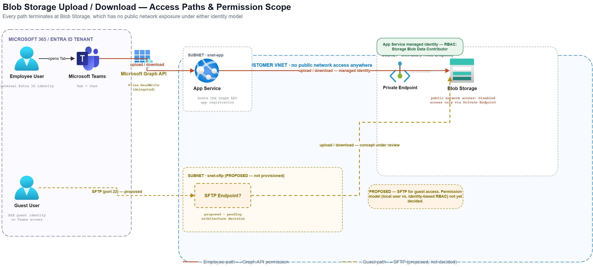

# Blob Storage Upload / Download — Access Paths & Permission Scope

Diagram source: [`otc-blob-access-boundaries.drawio`](otc-blob-access-boundaries.drawio) — open in [draw.io](https://app.diagrams.net/) or the draw.io Desktop app.

## Summary

- All document upload and download activity terminates at a single Blob Storage account that has **no public network access** — every path reaches it only through a Private Endpoint inside the customer VNet.
- **Employees** access Blob Storage through Microsoft Teams, via an App Service that holds a Microsoft Graph API app registration scoped to **`Files.ReadWrite` (delegated permission)**. The App Service's own managed identity then writes to Blob Storage under **Azure RBAC (Storage Blob Data Contributor)**.
- **Guest (B2B) users** do not have Teams access. A separate path is proposed using **SFTP** directly against Blob Storage's native SFTP endpoint — this is **under review and not yet decided**, including which permission model (local SFTP user vs. identity-based RBAC) would apply.
- No component in either path uses a storage account key or a public SAS URL — access is governed entirely by managed identity or delegated permission, scoped to the minimum role required.
